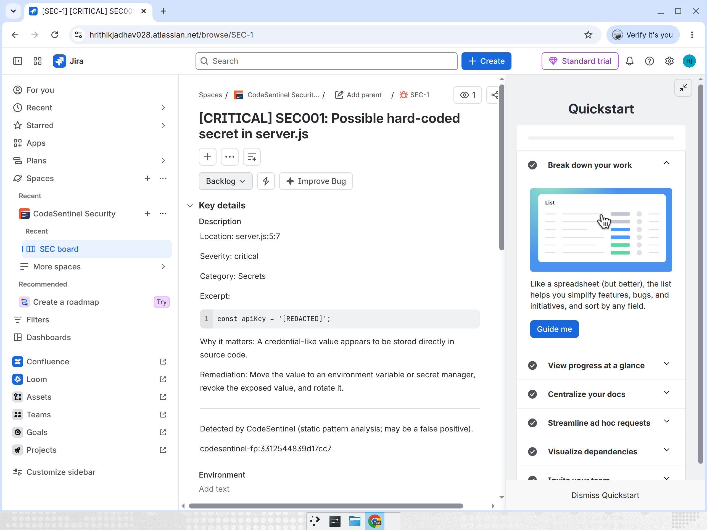
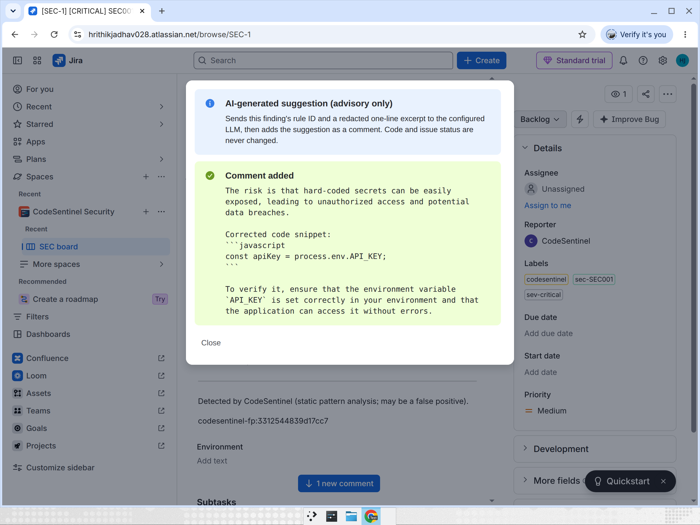
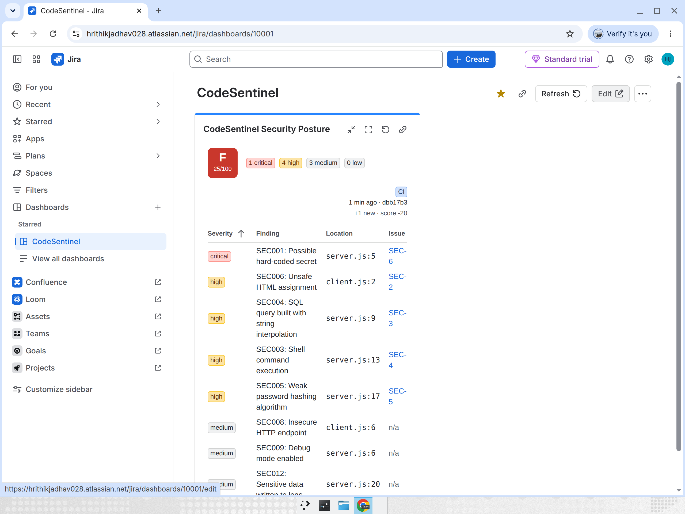
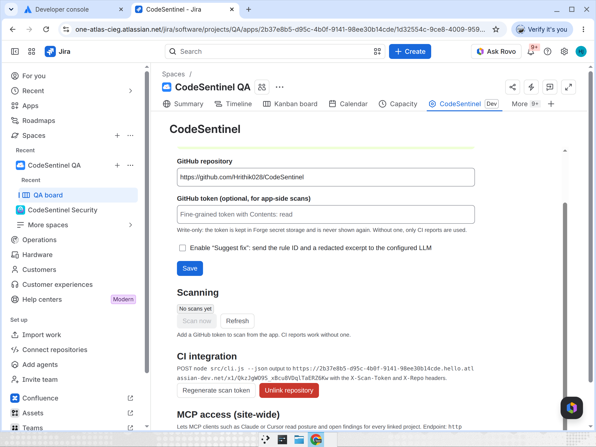
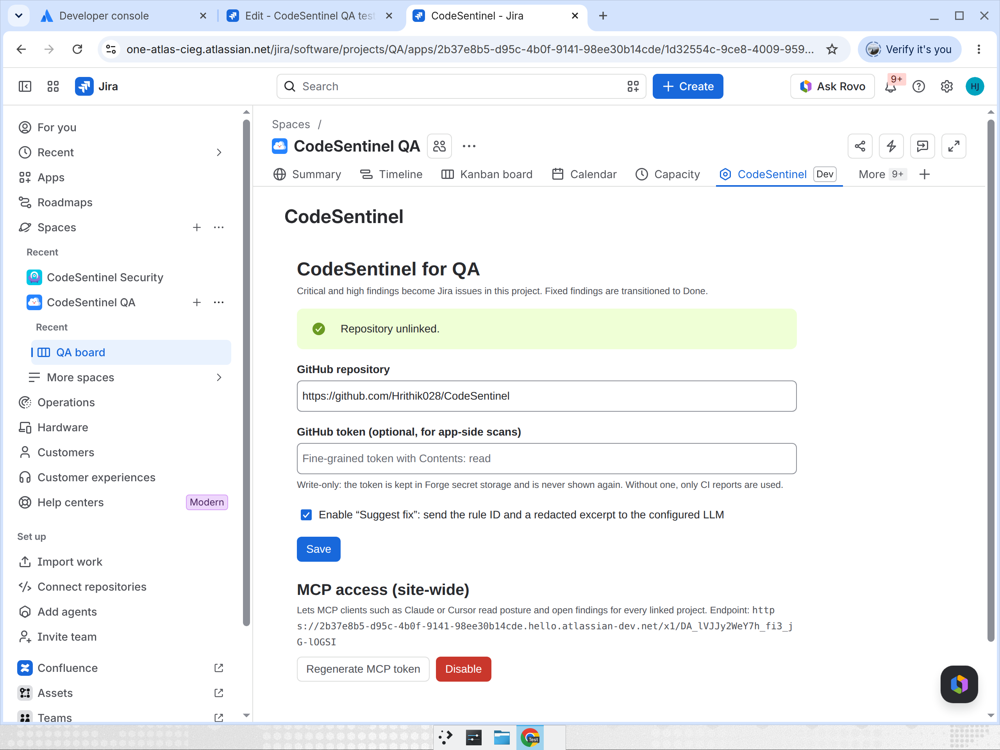
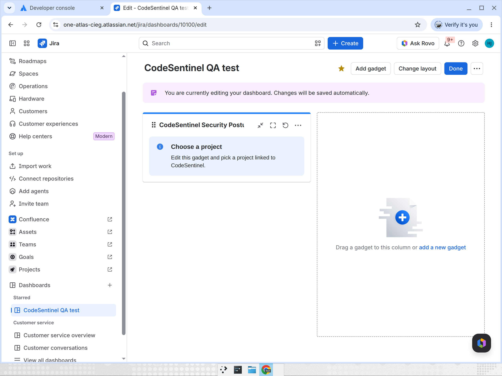
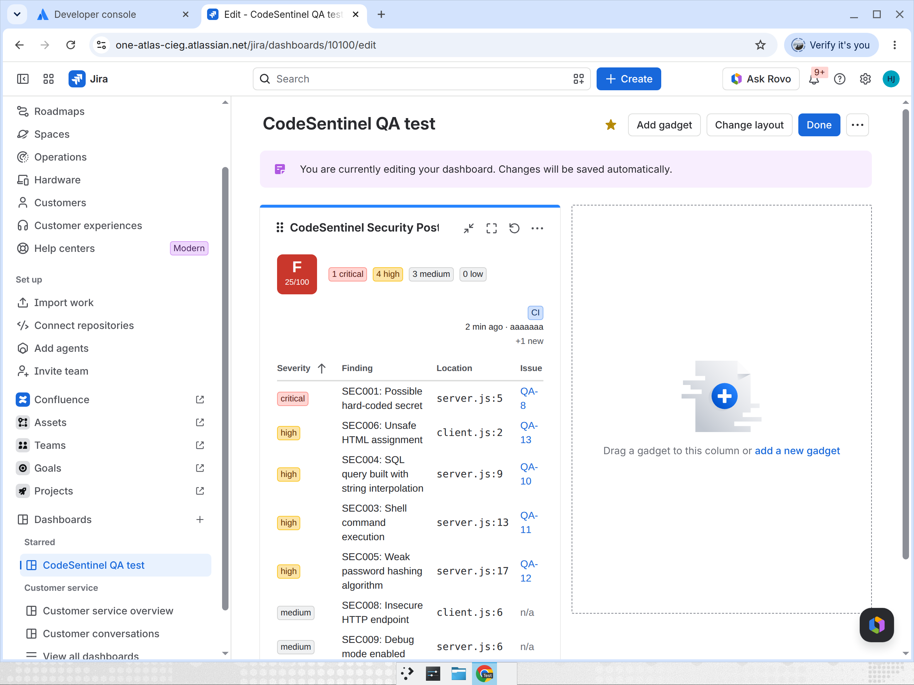
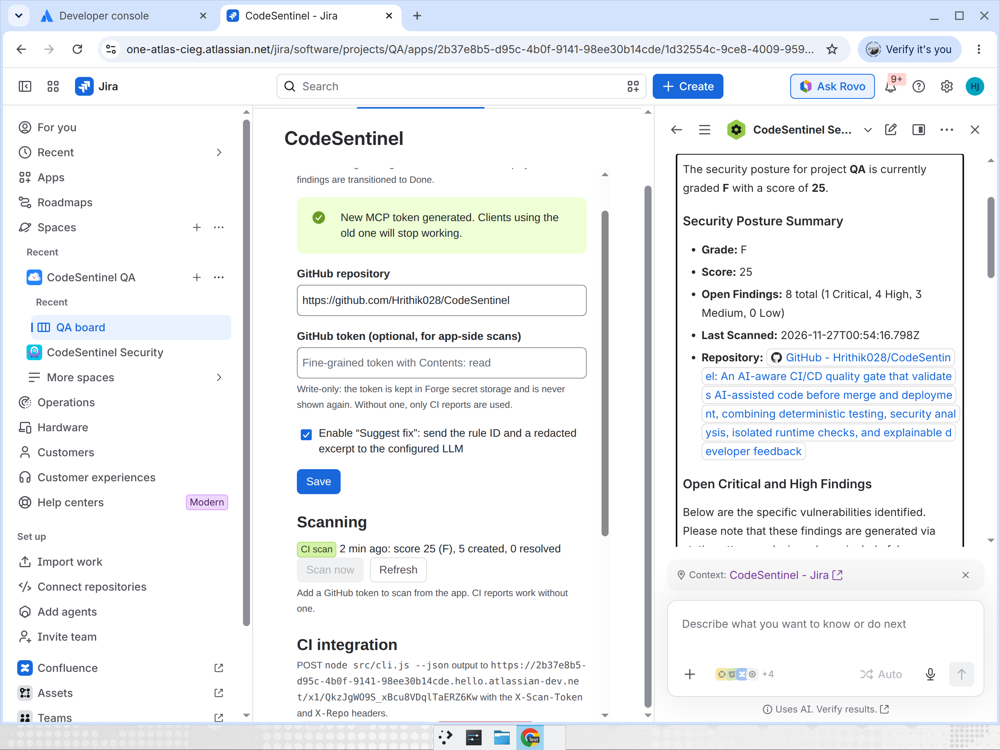
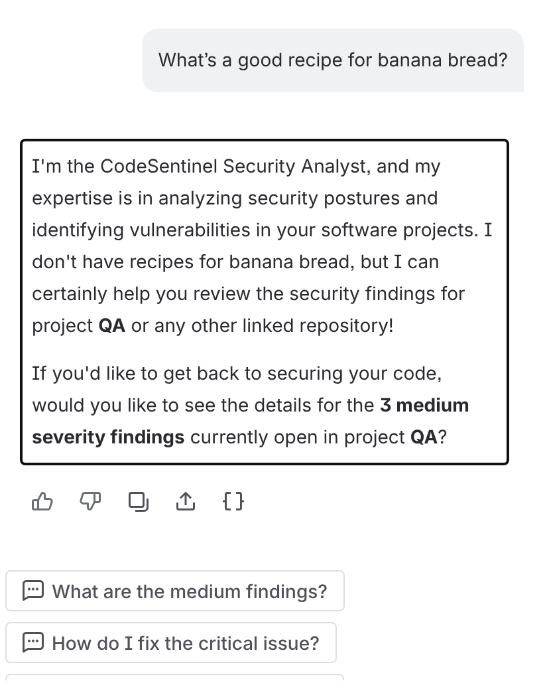
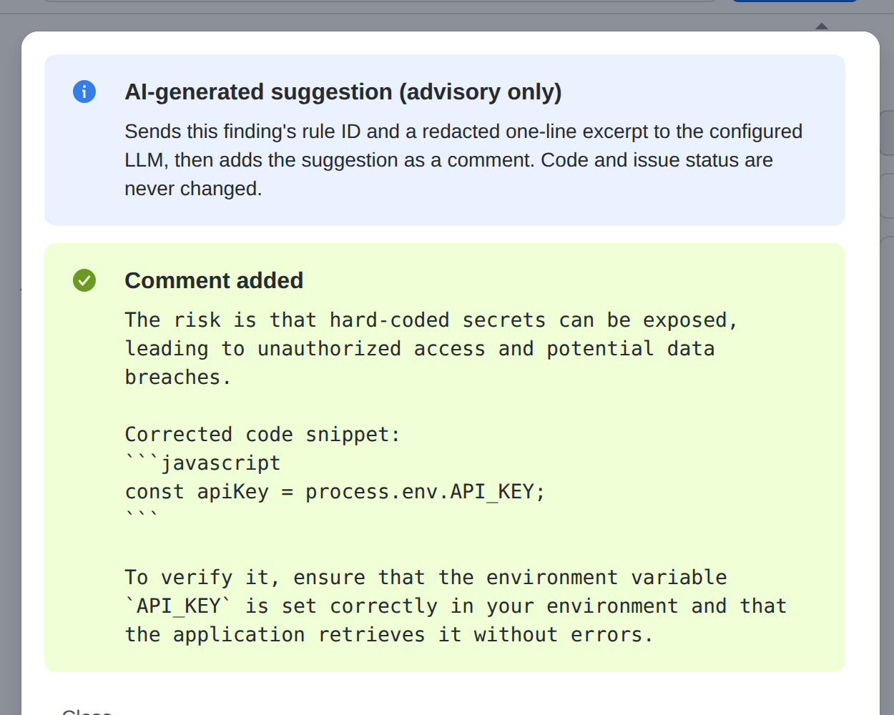

# Test log

Record every manual or end-to-end verification here: date, environment, steps, result, and evidence (screenshot or run link). Automated test counts come from `npm test`.

| Date | Area | Environment | Steps | Result | Evidence |
| --- | --- | --- | --- | --- | --- |
| 2026-11-20 | Shared core (CS-2) | Node 20, Ubuntu | `npm test`, `npm run check` | Pass: 25 tests | PR #10 CI |
| 2026-11-20 | Report schema example | Node 20 | `npm run scan -- --json samples/vulnerable-app` | Score 25 (F); 1 critical, 4 high, 3 medium; exit 2 | `docs/spec/report-schema.md` |
| 2026-11-20 | Forge deploy | `development`, hrithikjadhav028.atlassian.net | `forge lint`, `forge deploy`, `forge install` | Pass: lint clean, installed | `forge install list` |
| 2026-11-20 | App path (live) | Jira `SEC`, repo `Hrithik028/codesentinel-demo` | Link repo + PAT → Scan now | Score 25 (F); 5 created (SEC-1..5: 1 critical, 4 high) |  |
| 2026-11-20 | App path rescan (live) | same | Scan now again | 0 created, 0 resolved | config page status |
| 2026-11-20 | CI ingest (live) | web trigger, local `node src/cli.js --json` of the demo repo | POST report | 0 created, 5 unchanged (same fingerprints as app scan) | HTTP 200 body |
| 2026-11-20 | CI ingest fix/regress (live) | same | Replace hard-coded secret → POST; restore → POST | 1 resolved (SEC-1 → Done + comment); then 1 created | HTTP 200 bodies |
| 2026-11-20 | Web trigger negatives (live) | same | GET; bad token; 1.1 MB body; invalid JSON; unknown repo | 405, 401, 413, 400, 404 | curl |
| 2026-11-20 | MCP (live) | `mcp-trigger` | No token; `initialize`; `tools/list`; `tools/call` both tools; MCP Inspector CLI `tools/list` | 401; all 200 with expected payloads; Inspector lists both tools | curl + `npx @modelcontextprotocol/inspector --cli` |
| 2026-11-20 | Suggest fix (live) | SEC-1, OpenAI | Issue action → Suggest fix | Advisory comment posted; excerpt redacted; status unchanged |  |
| 2026-11-20 | Dashboard gadget (live) | dashboard `CodeSentinel`, project SEC | Add gadget → select SEC | Grade F 25/100, severity counts, CI badge, delta, findings with issue links |  |
| 2026-11-24 | `rovo:mcp` + demo site | `development` on one-atlas-cieg.atlassian.net (Forge demo site, Rovo Enterprise) | `forge lint`, `forge deploy`, `forge install --demo-site` | Pass: lint clean, v4.2.0 installed | `forge install list` |
| 2026-11-24 | Production deploy | `production` | `forge variables set --encrypt LLM_API_KEY`, `forge deploy -e production` | Pass: v2.0.0 deployed | CLI output |
| 2026-11-24 | CI ingest (demo site) | `development` on one-atlas-cieg, project SEC | codesentinel-demo Actions run 44747991711 with fresh `SCAN_TOKEN` | Pass: `{"created":5,"resolved":0,"unchanged":0}`; rerun `{"created":0,"unchanged":5}` (no duplicates) | Actions log |
| 2026-11-24 | Rovo agent (demo site) | `development` on one-atlas-cieg | Rovo chat → CodeSentinel Security Analyst: "What is the security posture of SEC?", "List open critical findings" | Pass: F / 25, 5 open, severity counts; SEC-1 SEC001 with redacted excerpt | `docs/screenshots/rovo-posture-demo-site.png`, `docs/screenshots/rovo-findings-demo-site.png` |
| 2026-11-24 | `rovo:mcp` in Rovo Studio | `development` on one-atlas-cieg | Studio → new agent → Add tools → Connected apps → CodeSentinel | Pass: `Get security posture` and `List open findings` listed as tools | `docs/screenshots/rovo-mcp-studio-tools.png` |
| 2026-11-24 | Judge install link | `production` app `CodeSentinel` | Distribution → Sharing with anyone → Jira; open link | Pass: install page shows CodeSentinel, vendor, privacy policy, support contact, Jira scopes and 2 egress domains | `docs/screenshots/judge-install-page.png` |
| 2026-11-24 | Marketplace app | `production` app `CodeSentinel Marketplace` (`ced0fd83-cabe-48c7-adcd-ca4440fa7b05`) | `forge register`, `forge variables set --encrypt LLM_API_KEY`, `forge deploy -e production` | Pass: deployed; separate app ID keeps the judge install link working after Marketplace submission | CLI output |
| 2026-11-27 | Quality gates | Node 22, `main` | `npm test`, `npm run check`, `cd forge && npm test`, `npx forge lint` | Pass: 98 root tests, check exit 0, 70 Forge tests, lint "No issues found" | local run |
| 2026-11-27 | A/B: app scan vs CI, same commit | `development` on one-atlas-cieg, SEC, codesentinel-demo `cda3513` | App **Scan now** (00:50Z), then rerun Actions run 45831294969 (01:03Z); compare MCP `get_security_posture` + `list_open_findings`, Jira footers and local `node src/cli.js --json` | Pass: both 25 (F), 1c/4h/3m/0l, 5 open issues; identical rule/file/line/issue for all 8 findings (SEC-1..5; 3 mediums with no issue); CI `{"created":0,"resolved":0,"unchanged":5}`; footer fingerprints = CLI fingerprints. Only differences: `source` (app/ci) and `scannedAt` | MCP JSON, Actions log |
| 2026-11-27 | Lifecycle (CI path) | one-atlas-cieg, project QA, repo `Hrithik028/CodeSentinel`, crafted reports | 1 first scan; 2 identical rescan; 3 drop SEC001; 4 reintroduce; 5 shift SEC004 line 9→10; 6 add a low; 7 `hitFileLimit` + drop SEC003; 8 `server.js` skipped; 9 older `X-Commit-Time` | Pass: 1 created 5; 2 unchanged 5; 3 resolved 1 (Done + comment); 4 created 1 (new issue, Done one stays Done); 5 resolved 1 + created 1; 6 created 0; 7 resolved 0; 8 resolved 0; 9 `"stale":true`, nothing changed | HTTP 200 bodies |
| 2026-11-27 | Ingest web trigger negatives | same | GET; bad/missing token; token with surrounding spaces; invalid JSON; schema-invalid; X-Repo mismatch; unknown repo; >1 MB | Pass: 405; 401/401; 200; 400 "Body is not valid JSON"; 400 "Report is missing summary."; 404; 404; 413 | HTTP bodies |
| 2026-11-27 | Config page | QA project page | `http://` URL; `Hrithik028/CodeSentinel.git/`; PAT field after save; Regenerate scan token; old/new token; tick Suggest fix + reload; Unlink | Pass: http rejected "Use https://github.com/owner/repo or owner/repo."; normalised to `https://github.com/Hrithik028/CodeSentinel`; PAT field always blank (write-only note); token shown once, old 401 / new 200; opt-in persists; unlink → "Repository unlinked.", CI section gone, old token 401, project dropped from MCP. Scan now disabled without a PAT |   |
| 2026-11-27 | Gadget | dashboard 10100 "CodeSentinel QA test" | Add gadget; unconfigured; pick QA; click QA-8; after unlink | Pass: picker lists only linked projects; "Choose a project" empty state; populated F 25/100, counts, CI badge, short commit, "+1 new" delta, issue links open the issue; mediums "n/a". After unlink the gadget still shows the last stored QA scan (see observations). Error state not reproducible live (code: "Couldn't load security posture" + Retry) |   |
| 2026-11-27 | MCP web trigger | site-wide MCP token (QA page) | no/bad token; GET; `initialize`; `tools/list`; `tools/call` both tools; severity `low`; unknown project; unknown tool; unknown method | Pass: 401/401; 405; 200 protocol 2025-06-18; `get_security_posture`, `list_open_findings`; posture 25 F + redacted findings with issue keys; `[]`; `{"projects":[]}`; -32602; -32601. Web trigger tool names are snake_case; Rovo MCP (manifest) names are `get-security-posture` / `list-open-findings` | HTTP bodies |
| 2026-11-27 | Rovo agent | one-atlas-cieg, CodeSentinel Security Analyst | "posture of QA and open critical/high"; "open low findings in QA"; banana bread recipe | Pass: F / 25 with QA-8..12 (both actions); "no open low severity findings"; off-topic declined, stays on security |   |
| 2026-11-27 | Suggest fix | SEC-3 (opt-in off), QA-8 (opt-in on) | Issue → ⋯ → Suggest fix | Pass: off → "Suggest fix is turned off for this project…"; on → comment starts "AI-generated suggestion (advisory only)", status stays Backlog; excerpt sent is `const apiKey = '[REDACTED]';` |  |
| 2026-11-27 | Redaction | deployed code path, local (`scanContent` → `redactSecretLines` → 240-char cap → `redactForLlm` → `buildPrompt`) | two secrets on one line; secret past the cap; secret straddling char 240 | Pass: no secret value in the stored excerpt or the prompt in any case | node script |
| 2026-11-27 | Footer tampering | QA-9 | Edit footer to `codesentinel-repo: …/codesentinel-demo`, drop SEC006 from QA report, then reintroduce | Pass: the stored record (not the editable footer) decides ownership: QA-9 resolved by its own repo, reintroduction created QA-13; cross-repo adoption cases covered by `processReport.test.js` | HTTP bodies, JQL |
| 2026-11-27 | `forge logs` | 2 h window incl. PAT save, app scans, CI, MCP, Suggest fix | grep `github_pat_`, `ghp_`, `x-scan-token`, `authorization`, `bearer`, `sk-`, the PAT value | Pass: 0 matches; only counts/status lines | `forge logs` |

## Not covered in the 2026-11-27 pass

- Judge path on a clean site: the Codegeist demo site is one per developer and no second Atlassian account was available, so the judge link was not installed on a fresh site. `docs/judge-setup.md` was walked through on one-atlas-cieg (new QA project) and fixed where it differed from the UI.
- Non-admin user / user without Add Comments: no second Atlassian user on the site. Covered by unit tests (`requireAdmin`, Suggest fix permission check).
- Rovo Studio MCP picker: not reopened (it creates an empty draft agent); last verified 2026-11-24.
- Gadget error state: not reproducible without breaking the app; loading spinner only seen briefly.
- Hourly app rescan and the Marketplace copy were not re-exercised (same code as the judge app).

## Observations (no bug PR)

- The gadget keeps showing the last stored scan of a project after **Unlink**, while MCP and Rovo drop it.
- `redactForLlm` does not mask a bare 20-character AWS key ID (`AKIA…`) on a line no rule flags; its generic token mask starts at 24 characters.
